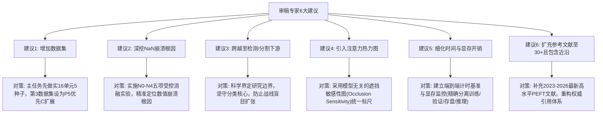
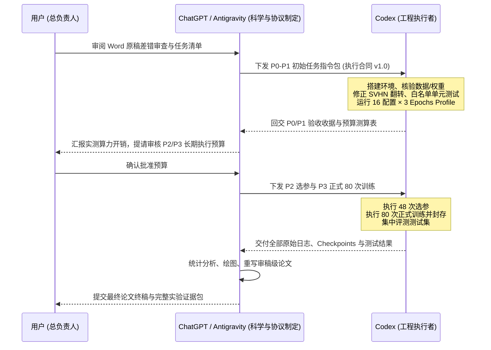

# 图像分类迁移学习：Word 原稿差错审查与执行任务清单

本文件针对原始论文稿件《资源受限场景下图像分类迁移学习策略的对比与实证研究》（以下简称 **Word 原稿**，含文末审稿建议）与《图像分类迁移学习实验设计与 Codex 执行合同 v1.0》（以下简称 **MD 合同**）进行系统对比与差异审计，明确指出原稿中的全部缺陷、工程错误、统计漏洞与科学口径偏差，并制定出切实可行的落地执行任务清单与实施路线图。

---

## 一、 两份文档的本质对比与定位映射

| 比较维度 | Word 原稿（论文初稿及审稿意见） | MD 执行合同（TL-CLS-20261020-v1.0） | 差距与升级目标 |
| :--- | :--- | :--- | :--- |
| **文档定位** | 一篇初步探索性质的中文期刊草稿，带有未修正的代码 Bug 与不严谨推论。 | 一份遵循国际顶级机器学习会议（ICML/NeurIPS/CVPR）标准的严谨科研规范与工程执行合同。 | 从“粗糙实验现象汇报”升级为“具备审稿级可信度、完全可复现的高质量学术成果”。 |
| **矩阵完整性** | 严重残缺：16 个实验单元仅成功完成 11 个；CIFAR-100 完全缺失 Adapter 实验。 | 完整闭环：严格定义 4（策略）× 2（骨干）× 2（数据集）= 16 个核心实验单元。 | 补齐所有缺失单元，消除信息缺口，拒绝选择性报告。 |
| **实验重复性** | 单随机种子（`seed=42`），点估计汇报，缺少方差与统计显著性。 | 固定 5 个预注册独立随机种子（17, 42, 2026, 3407, 65537），共 80 次正式训练。 | 引入均值、标准差、配对差值置信区间，提供统计学显著性支撑。 |
| **变量控制** | 变量严重耦合：训练轮数、Batch Size、学习率、预训练数据规模均不一致。 | 变量严格对齐：统一 50 epochs、有效 batch=128、学习率网格受控选择、独立控制预训练来源。 | 剥离干扰因子，确保方法比较建立在公平基线之上。 |
| **模型与代码** | 存在重大逻辑 Bug（通过 `'fc'` 关键字冻结导致 ViT 解冻了全部 MLP 层；残差初始化认知错误）。 | 白名单显式解冻、严格区分特征提取与分类头、Adapter 严格零初始化保证初始恒等映射。 | 彻底重构模型与冻结逻辑，编写自动化单元测试。 |
| **测试集使用** | 存在严重的数据窥探（Data Snooping）：在训练过程中逐轮测试，取测试集峰值（Best Top-1）。 | 严格划分 Train / Val / Test：超参数选择与 Checkpoint 选模仅依赖验证集，最终集中测试。 | 杜绝测试集泄露，维护机器学习评估的基本底线。 |
| **失败归因** | 主观武断：将单次 NaN 解释为“ViT 不可从头训练”或“Adapter 与 ViT 架构不兼容”。 | 假设驱动的因果诊断：设立 N0~N4 五组有界干预实验，严密排查数值范围、学习率与初始化。 | 用受控干预实验代替主观推测，形成可发表的失败分析。 |

---

## 二、 Word 原稿中出现的差错与缺陷系统清单

通过逐行逐段对比，Word 原稿在**实验设计**、**数据与代码**、**评价协议**、**文字公式排版**以及**学术引用**五个方面存在重大差错与缺陷：

### 2.1 实验设计与控制变量缺陷

1. **实验矩阵严重残缺，选择性报告结果**
   - **差错表现**：CIFAR-100 数据集上完全未执行 Adapter Tuning（无论是 ResNet-50 还是 ViT-B/16）；SVHN 上的 ViT 线性探测由于代码 Bug 变成了 Partial FT。原稿设计的 16 个单元中仅有 11 个单元完成了有效测试，却在结论中做出了宽泛的普适性归纳。
   - **学术后果**：审稿人可直接质疑实验不完整，无法支撑跨任务、跨架构的综合选型结论。

2. **架构比较与预训练数据规模严重混淆（Confounded Variables）**
   - **差错表现**：ResNet-50 采用 ImageNet-1K（约 128 万张图、1,000 类）预训练权重，而 ViT-B/16 采用 ImageNet-21K（约 1,400 万张图、21,841 类）AugReg 预训练权重。
   - **学术后果**：原稿将 ViT 线性探测的优异表现（88.65%）和 ResNet-50 线性探测的相对较低表现（73.83%）完全归因于“Vision Transformer 架构比 CNN 具备更强特征抽取能力”，完全忽视了预训练数据规模（10倍数据量、20倍类别多样性）的决定性影响。

3. **训练预算与超参数极度不公平**
   - **差错表现**：
     - 从头训练（From Scratch）设置 100 epochs；
     - 全量微调（Full FT）设置 30 epochs；
     - 线性探测（Linear Probing）设置 50 epochs，Batch Size 为 256；
     - 适配器微调（Adapter Tuning）设置 50 epochs，Batch Size 为 64/128。
   - **学术后果**：不同策略的优化迭代步数相差数倍，从头训练被给予了 3.3 倍于微调的训练轮数，不同策略之间的性能差异掺杂了训练预算差异。

4. **学习率主观指定，直接导致数值不稳定**
   - **差错表现**：ViT-B/16 的全量微调学习率设定为 `1e-4`，而 ViT-B/16 的 Adapter 微调却被硬编码设定为 `1e-3`（高出一个数量级）。
   - **学术后果**：在高学习率配合半精度（AMP FP16）的情况下，ViT 内部梯度更新剧烈，极易在第 21 轮引发数值溢出（NaN）。原稿不仅没有反思学习率超参数设置的不合理，反而倒果为因地声称“Adapter 天生不适合 ViT 架构”。

5. **两种骨干网络的 Adapter 容量与结构完全不匹配**
   - **差错表现**：
     - ViT-B/16 采用 Linear(768, 192) + GELU + Linear(192, 768)，参数增量仅 3.56M，可训练参数占比为 3.98%；
     - ResNet-50 采用在每个 Residual Block 后插入 Conv 1×1(c, c/4) + BN + ReLU + Conv 1×1(c/4, c) + BN，参数增量高达 10.12M，可训练参数占比高达 30.1%（几乎是微调了近三分之一的模型）。
   - **学术后果**：ResNet Adapter 的参数比例是 ViT Adapter 的近 8 倍。原稿将 ResNet-50 Adapter 在 SVHN 上的胜出归因于“卷积瓶颈的正则化”，而忽略了其巨大的参数容量优势。

---

### 2.2 数据处理与工程实现低级差错

6. **SVHN 数据集施加了错误的图像几何增强（RandomHorizontalFlip）**
   - **差错表现**：原稿第 4.4 节明确注明“所有图像均经过统一的预处理流程：训练集使用 `Resize(256) → RandomCrop(224) → RandomHorizontalFlip → ToTensor → Normalize`”。
   - **严重漏洞**：SVHN 是街景门牌数字识别任务（0–9）。对门牌数字进行随机水平镜像翻转会导致语义颠倒与破坏（例如数字“6”翻转后可能混淆为“9”，数字“2”、“3”、“5”、“7”水平镜像后成为非真实数字），给模型注入了大量错误的标签噪声。

7. **线性探测代码逻辑存在粗暴过滤 Bug，意外解冻超半数参数**
   - **差错表现**：原稿第 4.5 节自承：“因代码冻结逻辑通过参数名是否包含 `fc` 关键字来判断是否冻结，而 ViT 每个 Transformer 块的 MLP 层参数名（如 `blocks.X.mlp.fc1`）恰好包含 `fc`，导致 ViT 的所有 MLP 层被意外解冻”。
   - **严重漏洞**：这导致可训练参数飙升至 56.68M（占比 66.05%）。虽然原稿将其更名为 Partial FT，但它破坏了四策略在 SVHN 上的完整横向对比，且暴露了代码未经严格单元测试与参数白名单核验的工程隐患。

8. **适配器初始化存在数学认知错误**
   - **差错表现**：原稿第 3.4 节声称：“低维瓶颈限制了可学习参数的表达空间，同时残差连接确保了适配器在初始化时不改变主干网络的输出。”
   - **理论错误**：在线性或卷积分支中，如果权重和偏置采用常规随机初始化（如 Kaiming 或 Xavier 初始化），那么输入经过适配器分支后的输出非零，通过残差相加后在第 0 步就会立刻改变主干网络的特征输出！残差连接本身**绝不等于**恒等映射，必须显式将向上投影层（Up-projection）或末端 Batch Normalization 的权重/缩放因子（gamma）初始化为零。

9. **图像标准化常数未公布且存在潜在漂移**
   - **差错表现**：原稿仅模糊描述为“归一化参数使用各数据集的通道均值和标准差”，未公布具体浮点数值。
   - **工程隐患**：在迁移学习中，若骨干加载了 ImageNet 预训练权重，输入图像若使用目标小数据集统计量标准化而非预训练权重推荐的标准化常数，会直接造成底层特征提取器的协变量漂移。

---

### 2.3 评估协议与统计学漏洞

10. **严重的数据窥探（Data Snooping）：测试集参与选模**
    - **差错表现**：原稿第 4.3 节明确将主指标定义为“Top-1 准确率，取训练过程中的最高值（Best Top-1）”，并在表 5 中逐 Epoch 监测 Test Top-1。
    - **学术后果**：用最终的测试集（Test Set）来挑选最佳 Epoch Checkpoint，严重违反了机器学习评估准则，导致测试泛化性能被系统性高估。

11. **单随机种子（`seed=42`），微小差距缺乏统计显著性支持**
    - **差错表现**：所有实验仅运行一次随机种子。
    - **过度解读**：
      - 在 CIFAR-100 上，ViT 线性探测为 88.65%，全量微调为 88.19%，两者仅相差 **0.46 个百分点**（在 10,000 张测试集中对应 46 张图片的波动），原稿据此大篇幅宣称“线性探测超越全量微调”；
      - 在 SVHN 上，ResNet-50 Adapter（96.25%）与 From Scratch（95.86%）仅相差 **0.39 个百分点**，同样处于单次训练随机扰动的置信区间之内。

12. **数值崩溃（NaN）后的非科学汇报与机制误判**
    - **差错表现一**：ViT-B/16 Adapter 在第 21 轮损失变为 NaN 后，原稿将后续训练中模型预测坍缩至单类别的 argmax 准确率 **6.70%** 作为合法的“最终轮次准确率（Final Top-1）”填入正式表格。NaN 发生后模型的权重已经失效，输出 6.70% 无任何科学评价意义。
    - **差错表现二**：原稿在第 5.2 节声称“第 21 轮训练损失突然变成 NaN，梯度消失”。数学上，损失变为 NaN 通常是由半精度下梯度爆炸（Gradient Explosion）、数值溢出（Overflow）或激活值未受控放大引起的，绝不是“梯度消失”。

---

### 2.4 文本、公式排版与算术差错

13. **排版乱码与符号丢失（Word 格式转换瑕疵）**
    - **符号乱码**：实数空间符号 `\mathbb{R}` 被 Word 数学公式编辑器转码为中文字符“耽”，例如：“给定图像 `x ∈ 耽H×W ×C`”、“`Wdown ∈ 耽d×r`”、“`Wup ∈ 耽r×d`”。
    - **符号丢失**：Pan 等人的形式化定义中，不等号 `≠` 丢失并被转为内嵌损坏图片或占位符，排版显示为“`其中 Ds [图] Dt 或 Ts [图] Tt`”。
    - **减号与汉字混淆**：残差公式中减号被错误打成全角汉字“一”，如“`F(x, {Wi}) 一 x`”；科学计数法中的负号被打成长划线“`1 × 10—4`”。

14. **参数量除法换算与舍入误差**
    - **差错表现**：原稿第 5.3 节声称 ViT 线性探测参数量（0.08M，精确值为 76,900）为全量微调（85.88M，精确值为 85,875,556）的 **1/1073**。
    - **精确计算**：`76,900 / 85,875,556 = 1 / 1116.71`（约 1/1117）。原稿的 1/1073 是因为拿粗糙舍入后的 `0.08 / 85.88` 进行相除所致，在严谨的技术报告中存在数值失真。

---

### 2.5 参考文献差错与前沿性不足

15. **虚假/错误的参考文献条目**
    - **差错条目**：原稿参考文献 [4]：
      > `Z. Han, C. Gao, J. Liu, S. Peng, D. Wu, X. Jin, H. Lai, Z. Ni, F. Zhang, et al., “Parameter-efficient fine-tuning for pre-trained vision models: A survey and benchmark,” IEEE Trans. Pattern Analysis and Machine Intelligence, 2024.`
    - **查证事实**：该综述论文实际上是 Yi Xin 等人发表于 arXiv 的预印本（arXiv:2402.02242），2025 年末最新版本状态为 Submitted to IJCV，且作者排序中并未在 IEEE TPAMI 2024 正式刊出。直接标注为 TPAMI 属于严重的文献核验失误。

16. **文献体量与时效性严重滞后**
    - **表现**：原稿仅有 18 篇参考文献，绝大多数发表于 2022 年以前，完全缺失了 2023–2026 年视觉参数高效微调（Visual PEFT）领域的代表性工作（如 AdaptFormer、VPT、Basu 等的 AAAI 2024 基准研究、Mercea 等的 CVPR 2024 效率评估等）。

---

## 三、 对审稿人意见（“文章建议”）的逐条剖析与应对对策

文末附带的专家评审意见直击了论文的薄弱环节，我们需要在本次升级中采取理性的应对策略：

1. **审稿建议一：“在更多的数据集上做测试，把文章做饱满”**
   - **科学应对**：不能在现有两个数据集（CIFAR-100、SVHN）的基础漏洞尚未修补的情况下盲目铺开新数据集。首要任务是**补全当前 16 种核心配置并跑满 5 个种子（80 次运行）**。在此坚实基准之上，将第三个分类数据集（如 Oxford Flowers-102 或 Food-101）列为 **P5 阶段的优先级 C 候选**，由项目负责人统筹算力决定。

2. **审稿建议二：“在模型出现 NaN 的时候，寻找一下原因是什么”**
   - **科学应对**：完全采纳。在 MD 合同第十节设立专门的 **N0~N4 有界诊断矩阵**，从“是否启用混合精度（FP32 vs FP16 vs BF16）”、“学习率量级（`1e-3` vs `1e-4`）”、“Adapter 输出分支零初始化”等维度进行单变量排查，彻底搞清第 21 轮崩溃的机理。

3. **审稿建议三：“下游任务拓展到分类、分割、识别等不同任务”**
   - **科学应对**：需谨慎对待。目标检测与语义分割需要完全不同的检测头、多尺度特征金字塔（FPN）、复杂损失函数与庞大的计算资源。资源受限场景下强行跨任务会导致研究聚焦发散。合同将本项目严格约束在**“图像分类基准”**上，把分类任务下的特征迁移机理研究透彻。

4. **审稿建议四：“加入热力图，看网络对图的注意力是否真正学到关注点”**
   - **科学应对**：采纳并规范化。直接对比 CNN 的 Grad-CAM 与 ViT 的 Self-Attention Rollout 在量纲与物理含义上并不对齐。合同第 12.3 节提出**“基于滑动窗口的遮挡敏感性分析（Occlusion Sensitivity Maps）”**，用纯前向干预的同一标尺生成注意力热力图，并在验证集上预先抽取固定展示池。

5. **审稿建议五：“训练时间、参数量、内存开销加入论文体现差别”**
   - **科学应对**：完全采纳。合同第八节与第十二节要求详尽记录：
     - 时间开销：区分训练循环时间（`train_seconds`）、验证时间、检查点写入时间及总耗时（`fit_wall_seconds`）；
     - 显存占用：监测全程显存峰值（`max_memory_allocated` 与 `max_memory_reserved`）；
     - 存储开销：严格区分任务增量权重（LP 分类头 / Adapter 模块）与完整部署文件大小。

6. **审稿建议六：“参考文献数量需达到 30+，补充 2023 年以后的近沿成果”**
   - **科学应对**：完全采纳。彻底剔除有事实错误的引用，引入近 3 年关于视觉参数高效微调、模型可迁移性与计算资源权衡的高水平期刊与顶会论文，将参考文献规模扩充至 32 篇以上。

---

## 四、 我们需要做的：全流程执行任务清单与实施路线图

根据 MD 执行合同，我们的完整工作分解为 **P0 至 P4（以及可选 P5）** 五个严密衔接的阶段：

### 4.1 任务阶段分解表

| 阶段 | 核心任务内容 | 计划执行量 | 交付物与验收标准 |
| :--- | :--- | :--- | :--- |
| **P0 阶段：基础工程与代码正确性验收** | 1. 锁定环境依赖与设备配额； 2. 下载并核验官方数据与权重 Hash； 3. 修复 SVHN 预处理（去除水平翻转）； 4. 重构模型定义，实现严格白名单冻结； 5. 显式零初始化 Adapter 并验证初始恒等； 6. 验证断点续训状态恢复一致性。 | 0（不启动长周期训练） | - `records/preflight.json` - `records/implementation_checks.json` - 单元测试通过，白名单完全匹配。 |
| **P1 阶段：短程 Profile、双卡基准与 NaN 排查** | 1. 16 种配置运行 3 个完整 Epoch（种子 314159）； 2. 测量每轮真实耗时、吞吐量、显存峰值； 3. 评估双卡并行下的资源争用慢化比； 4. 静态核查与短程复现历史 NaN 现象； 5. 外推长程正式实验的总计算耗时与磁盘需求。 | 16 配置 × 3 epochs = **48 epochs**（上限 4 GPU-hours） | - `records/budget_plan.json` - NaN 首次异常触发监控快照； - 长期预算与双卡排程确认书。 |
| **P2 阶段：受控学习率选择（选参）** | 1. 严格在预注册的 3 个候选学习率中探索； 2. 针对 16 个单元各跑 3 个候选（共 48 次）； 3. 每次仅跑前 15 epochs（调度按 50 轮规划）； 4. 依据第 13–15 轮验证集 Top-1 平均值定标。 | 48 候选 × 15 epochs = **720 epochs** | - `manifests/selected_hparams.json` - 调参过程日志与选择理由； - 正式超参数全面冻结。 |
| **P3 阶段：正式五种子主矩阵执行** | 1. 启动 16 种配置 × 5 个正式随机种子； 2. 统一训练 50 epochs，有效 Batch=128，采用 BF16； 3. 训练全流程仅通过验证集选模并保存 `best_val.pt`； 4. 所有运行封存后，由独立入口集中评估 Test 集。 | 80 次训练 × 50 epochs = **4,000 epochs** | - `runs/<run_id>/` 原始收据与日志； - 统一测试评估预测文件与混淆矩阵。 |
| **P4 阶段：统计学分析、可视化与论文终稿重构** | 1. 计算 5 种子均值、标准差与配对差值 t-区间； 2. 绘制精度-算力散点图、收敛曲线与遮挡敏感性图； 3. 全面重构论文正文（修正前述所有学术缺陷）； 4. 扩充文献至 32+ 篇，规范引用格式。 | 使用 P3 产出的全部证据 | - 审稿级主结果表与矢量图表（PDF/SVG）； - 全新重构的《图像分类迁移学习实证研究》论文终稿。 |
| **P5 阶段：战略性扩展（按需启动）** | 1. CIFAR-100 10% 样本少样本微调（40 次）； 2. ViT ImageNet-1K 权重对照（30 次）； 3. AdaptFormer / LN-Tune 强基准比对。 | 视用户预算审批另行制定 | - 独立版本补充报告与附录。 |

---

### 4.2 核心实施要点与工程硬约束

#### 1. 严格的参数量核算基准
Codex 在构建模型时，必须核对以下理论参数量（纯线性分类头，无额外偏差）：
- **ResNet-50 线性探测**：SVHN（10类）为 20,490 个参数（0.087%）；CIFAR-100（100类）为 204,900 个参数（0.864%）。
- **ViT-B/16 严格线性探测**：SVHN（10类）为 7,690 个参数（0.009%）；CIFAR-100（100类）为 76,900 个参数（0.090%）。
- **ResNet-50 Canonical Adapter**：新增参数总量 10,097,536，在 SVHN 上可更新参数占比为 30.09%，在 CIFAR-100 上为 30.47%。
- **ViT-B/16 Canonical Adapter**：新增参数总量 3,550,464，在 SVHN 上可更新参数占比为 3.98%，在 CIFAR-100 上为 4.06%。

#### 2. 数据隔离与防泄露机制
- CIFAR-100 严格划分：45,000 张训练、5,000 张验证（每类精准 50 张）、10,000 张测试。
- SVHN cropped 32×32 严格划分：65,931 张训练、7,326 张验证、26,032 张测试。
- **红线**：训练阶段严禁构建 `test_evaluator`，测试集标签绝对不得参与任何学习率选择、Early Stopping 或参数保存。

#### 3. 数值精度与稳定性防护
- 主实验抛弃容易溢出的传统 FP16，全面升级为 **BF16 混合精度训练**（Autocast BF16，优化器与权重保持 FP32，Loss 计算转回 FP32）。
- 梯度裁剪严格设定全局范数上限 `max_norm=1.0`。
- 若遇到非有限值（NaN/Inf），必须在 `optimizer.step()` 前拦截并记录现场，禁止写入脏权重，更禁止继续 argmax 汇报单类虚假准确率。

---

## 五、 三方角色协同矩阵与近期动作

### 5.1 各角色权责明细
1. **用户（总负责人）**：
   - 监督项目进展，掌握总预算控制权；
   - 审阅 P1 阶段回交的真实显卡耗时外推预算，拍板是否按计划推进 P2/P3 的 4,000 个正式 Epochs；
   - 最终决定是否投稿或追加 P5 扩展实验。
2. **ChatGPT / Antigravity（科学顾问与技术仲裁）**：
   - 制定科学协议，监督工程落地的合规性；
   - 严把测试集隔离、控制变量与统计方法关口；
   - 依据 Codex 回传的原始收据，撰写统计分析报告并重写学术论文。
3. **Codex（工程实施者）**：
   - 遵照 `protocol.json` 与 `run_matrix.json` 编写训练和评估脚本；
   - 严格执行 P0 阶段的技术测试（白名单参数断言、BN 状态审计、零初始化验证）；
   - 保障长周期任务在服务器双卡上的平稳运行，保存不可篡改的原始训练收据。

---

## 六、 总结与即刻执行指令

通过本次系统审计，Word 原稿中显露的实验残缺、代码 Bug（解冻 MLP、翻转门牌号）、数据窥探（测试集选模）和武断归因已全部定位并制定了对策。

### 下一步即刻采取的动作：
立即将 MD 执行合同中的 **第十五节《首轮执行任务（P0–P1）》** 正式指令下发给 Codex，在服务器独立环境 `/root/autodl-tmp/tl_cls_benchmark` 中就位：
1. 搭建运行环境，核验 `torch 2.5.1+cu124` 与 `timm 1.0.12`；
2. 下载并验证 SVHN 与 CIFAR-100，生成防混淆的划分索引；
3. 完成模型架构与参数白名单的单元测试；
4. 运行 16 个配置的 3-Epoch 短程试跑，实测双卡运行性能并回传第一轮测算报告。
