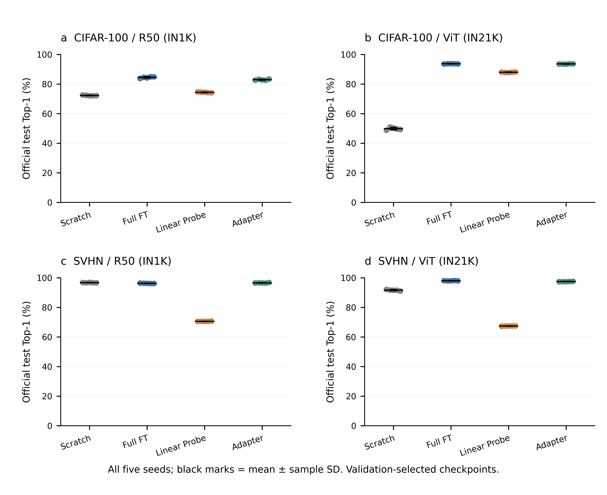
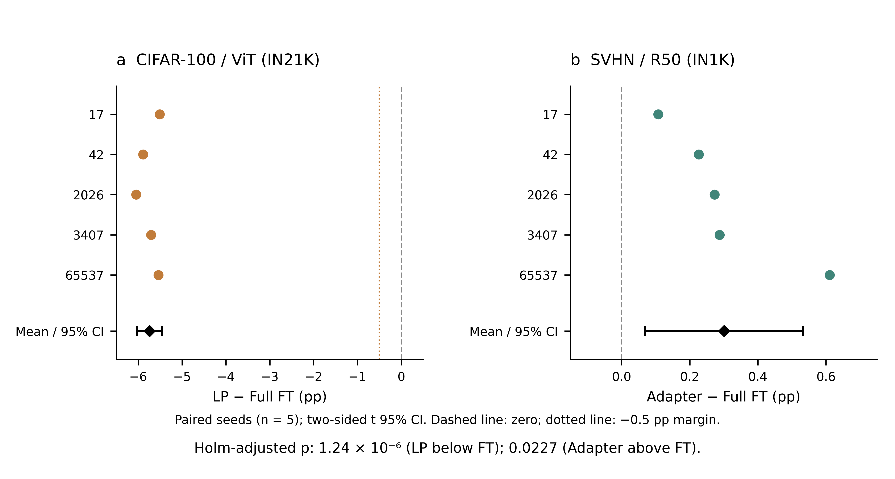
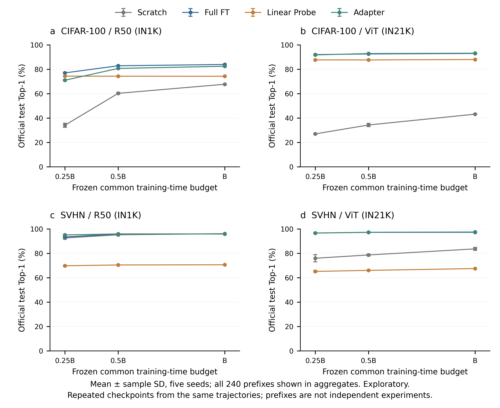

# P3-C 集中测试：完整结果与验收报告

交付日期：2026-10-28。**工程验收 PASS：400/400 项完成，全部 96 个 P3 attempt 已结算（历史 92 + 本轮 4），评价结果已封存，等待 PI 审查。** 本轮没有新训练、测试后调参、重选 checkpoint、失败重试或漏报种子。

两项事先固定的主问题结论不同：CIFAR-100/ViT 的 Linear Probe 比 Full FT 低 **5.740pp**，未达到 −0.5pp 非劣要求；SVHN/ResNet-50 的 Adapter 比 Full FT 高 **0.301pp**，两项检验 Holm 校正后 p=0.0227。后者只支持 Adapter 相对 Full FT 的优势，不能推广为所有策略最优。

本轮消耗 **2.072720 / 3 GPU-hours**，P3 累计 **126.683330 / 160 GPU-hours**。原始预测和 checkpoint 全部留在原服务器项目 `/root/user_data/tl_cls_v1`；公开 GitHub 仅交付文本证据、指标、图和哈希。

## 1. 实际执行与授权

- 冻结目标：80 个验证集 best 主评价 →80 个 last 次评价 →240 个固定预算前缀；所有类别完成后才进入下一类别，各类按 run_id/预算比例固定排序。实际 dispatch 的全部 400 个 ordinal 和两个类别间完成屏障均已复核。
- 80 个训练 run、16 配置，固定 seed：17、42、2026、3407、65537。每个配置/角色/预算点均保留五个 seed；CIFAR-100 每项 10,000 个 test 样本，SVHN 每项 26,032 个 test 样本。
- PI 最新明确授权覆盖合同 G2 的独立签署要求：本轮为直接 PI 授权，独立签发已豁免。没有把执行账户的 HMAC 误称为独立人类签名。授权原文、模式及授权 SHA 见直接授权补充与签署回执。
- 服务器实际执行 commit 为 `700a1adcba85e03896dfafa303959f8d035008aa`；本轮四个监督/统计工具源码 SHA 与 28 项 CPU 验收、实际双 GPU 验收和服务器收尾记录一致。GitHub 的交付 commit 与运行 commit 分开。未修改 seal 覆盖的 `src/`。
- CPU 合成故障注入 28/28 通过；两张 GPU 的无官方 test 合成验收均通过。正式运行前调用原始严格授权入口，本轮没有绕过科学身份、签名、manifest 或 checkpoint 校验。

## 2. 正式主指标：验证集选定 best 的官方 test Top-1

下表为五 seed 的均值±**样本 SD**（百分数）。SD 表示训练随机性；不是置信区间。best 由既有 validation 轨迹选定，没有根据 test 选 best/last。

| 数据 / 骨干 / 方法 | n | Test Top-1 (%) | Macro-F1 | Balanced accuracy | NLL |
|---|---:|---:|---:|---:|---:|
|cifar100-r50-adapter|5|82.934 ± 0.348|0.8296|0.8293|0.8729|
|cifar100-r50-full_ft|5|84.484 ± 0.480|0.8446|0.8448|0.7377|
|cifar100-r50-linear_probe|5|74.396 ± 0.237|0.7437|0.7440|0.8756|
|cifar100-r50-scratch|5|72.272 ± 0.207|0.7220|0.7227|1.6177|
|cifar100-vitb16-adapter|5|93.588 ± 0.110|0.9359|0.9359|0.3791|
|cifar100-vitb16-full_ft|5|93.688 ± 0.099|0.9369|0.9369|0.4679|
|cifar100-vitb16-linear_probe|5|87.948 ± 0.162|0.8796|0.8795|0.4836|
|cifar100-vitb16-scratch|5|49.788 ± 0.837|0.4937|0.4979|3.2642|
|svhn-r50-adapter|5|96.574 ± 0.131|0.9631|0.9634|0.2772|
|svhn-r50-full_ft|5|96.273 ± 0.104|0.9602|0.9609|0.2522|
|svhn-r50-linear_probe|5|70.601 ± 0.085|0.6901|0.6866|0.8990|
|svhn-r50-scratch|5|96.742 ± 0.117|0.9652|0.9653|0.2000|
|svhn-vitb16-adapter|5|97.469 ± 0.084|0.9730|0.9740|0.2182|
|svhn-vitb16-full_ft|5|97.993 ± 0.111|0.9788|0.9793|0.2537|
|svhn-vitb16-linear_probe|5|67.407 ± 0.060|0.6609|0.6556|0.9954|
|svhn-vitb16-scratch|5|91.633 ± 0.376|0.9085|0.9089|0.3005|

Macro-F1 和 balanced accuracy 使用 0–1 标度；NLL 为逐样本自然对数损失。逐角色 CSV 包含每个 evaluation_id 的 n、正确数、全部指标、checkpoint/预测 SHA、预算及 GPU 事务耗时；混淆矩阵包含在逐项完成回执和归档中。各辅助指标的五 seed SD 也在配置汇总 CSV 中保留。

## 3. 两项预注册配对比较

| 比较 A−Full FT | 五配对差值均值 / pp | 样本 SD / pp | 95% 配对 t 区间 / pp | 双侧 p | Holm 校正 p | 裁定 |
|---|---:|---:|---|---:|---:|---|
|CIFAR-100 / ViT：LP−FT|−5.740|0.230|[−6.026, −5.454]|6.2204×10⁻⁷|1.2441×10⁻⁶|LP 显著低于 FT；LP 优越性不成立；非劣性不成立|
|SVHN / R50：Adapter−FT|+0.301|0.187|[+0.069, +0.533]|0.022734|0.022734|在预注册比较中 Adapter 优于 FT|

使用相同五个训练 seed 配对，df=4，CI=均值±t(0.975,4)×样本SD/√5。两个双侧配对 t 检验共同做 Holm 校正，方向另按差值符号解释；负的显著差值不会被称为 A 优越。CI 是各比较的普通 95% 区间，**没有作同时区间校正**。

LP 的预注册非劣规则要求 95% 双侧区间下界严格大于 −0.5pp；实际 −6.026pp，故未通过，不能事后改阈值。上述推断基于五 seed 差值的 t 模型，反映固定测试集上的训练随机性，不包含重新抽样测试人群的不确定性，也不支持泛化到任意数据集。

逐 seed 的 A、FT 和差值见 `P3_C_主比较差值.csv`。服务器与本地分别重新计算统计，全部字段相符；没有缺失 seed 或改变分母。

## 4. 次评价和探索性结果

以下 last 对比仅为事先冻结的次评价描述，不用来替换主 best 结论。未为 16 个配置事后添加正式显著性检验。

| 配置 | best Test Top-1 均值 (%) | last 均值 ± SD (%) | last−best 五 seed 配对均值 / pp |
|---|---:|---:|---:|
|cifar100-r50-adapter|82.934|83.090 ± 0.290|+0.156|
|cifar100-r50-full_ft|84.484|84.684 ± 0.140|+0.200|
|cifar100-r50-linear_probe|74.396|74.260 ± 0.044|-0.136|
|cifar100-r50-scratch|72.272|72.262 ± 0.203|-0.010|
|cifar100-vitb16-adapter|93.588|93.676 ± 0.198|+0.088|
|cifar100-vitb16-full_ft|93.688|93.704 ± 0.117|+0.016|
|cifar100-vitb16-linear_probe|87.948|88.036 ± 0.098|+0.088|
|cifar100-vitb16-scratch|49.788|49.792 ± 0.756|+0.004|
|svhn-r50-adapter|96.574|96.580 ± 0.076|+0.006|
|svhn-r50-full_ft|96.273|96.234 ± 0.100|-0.039|
|svhn-r50-linear_probe|70.601|70.633 ± 0.051|+0.032|
|svhn-r50-scratch|96.742|96.802 ± 0.087|+0.061|
|svhn-vitb16-adapter|97.469|97.513 ± 0.074|+0.044|
|svhn-vitb16-full_ft|97.993|97.981 ± 0.123|-0.012|
|svhn-vitb16-linear_probe|67.407|67.498 ± 0.050|+0.091|
|svhn-vitb16-scratch|91.633|91.689 ± 0.312|+0.057|

值得保留的探索性边界：CIFAR-100/ViT 的 Adapter 为 93.588%，FT 为 93.688%，差 −0.100pp；这不能称为正式等效或非劣。SVHN/R50 的 Scratch 为 96.742%，高于 Adapter 的 96.574%，故 Adapter 的预注册 FT 优势不等于全策略第一。CIFAR-100/ViT Scratch 完整训练后的 test 为 49.788%；不能将较低准确率改写成“无法训练/必然 NaN”。

R50 使用 IN1K、ViT 使用 IN21K 来源，训练数据和预训练来源不同，跨骨干差异不能归因于架构本身。SVHN 的两种 LP 均明显落后各自 FT，支持“省训练成本伴随明显任务相关精度代价”的描述，不支持普遍无代价替代。

## 5. 固定共同时间预算前缀：探索性效率证据

B、前缀 checkpoint 和允许的最近已提交 epoch 均在 test 前冻结；每行五 seed，以下为均值±样本 SD。240 个前缀来自既有 80 条训练轨迹，不能当成 240 次独立训练或额外 seed。

| 配置 | 0.25B Test (%) | 0.5B Test (%) | B Test (%) |
|---|---:|---:|---:|
|cifar100-r50-adapter|71.002 ± 0.623|80.704 ± 0.244|82.450 ± 0.248|
|cifar100-r50-full_ft|77.024 ± 0.414|82.878 ± 0.290|83.916 ± 0.260|
|cifar100-r50-linear_probe|74.378 ± 0.122|74.302 ± 0.134|74.266 ± 0.062|
|cifar100-r50-scratch|34.084 ± 1.691|60.264 ± 0.726|67.708 ± 0.366|
|cifar100-vitb16-adapter|91.780 ± 0.259|92.876 ± 0.170|93.160 ± 0.117|
|cifar100-vitb16-full_ft|92.030 ± 0.113|92.564 ± 0.059|92.964 ± 0.194|
|cifar100-vitb16-linear_probe|87.696 ± 0.201|87.652 ± 0.168|88.000 ± 0.119|
|cifar100-vitb16-scratch|26.980 ± 0.447|34.296 ± 1.365|43.168 ± 0.391|
|svhn-r50-adapter|95.085 ± 0.435|95.953 ± 0.143|95.877 ± 0.133|
|svhn-r50-full_ft|93.426 ± 0.362|95.928 ± 0.201|95.867 ± 0.138|
|svhn-r50-linear_probe|69.829 ± 0.374|70.474 ± 0.076|70.632 ± 0.066|
|svhn-r50-scratch|92.639 ± 1.005|95.217 ± 0.623|96.156 ± 0.117|
|svhn-vitb16-adapter|96.645 ± 0.133|97.224 ± 0.114|97.255 ± 0.122|
|svhn-vitb16-full_ft|96.677 ± 0.328|97.293 ± 0.229|97.477 ± 0.178|
|svhn-vitb16-linear_probe|65.197 ± 0.730|66.044 ± 0.185|67.531 ± 0.054|
|svhn-vitb16-scratch|75.979 ± 2.944|78.679 ± 0.764|83.665 ± 1.217|

CIFAR-100/ViT 的 Adapter 在 0.25B/0.5B/B 为 91.780/92.876/93.160%，FT 为 92.030/92.564/92.964%。这是在原训练时间截点下的描述性取舍；未针对测试分数更新 B 或重选快照。各配置逐 seed 的实际预算秒数及 checkpoint SHA 见逐项回执，训练验证前缀的 epoch 见历史 P3 预算清单。

## 6. 成本、异常和资源台账

| 计量项 | GPU-hours |
|---|---:|
|P3-B 已封存历史|124.610609507|
|双 GPU 合成工程验收（含严格授权与加载）|0.188572801|
|80 主 best 事务|0.343034613|
|80 次 last 事务|0.360239353|
|240 预算前缀事务|1.027167754|
|正式 attempt 的授权、启动、等待与退出等未分项开销|0.153705513|
|P3-C 全部新增占用 / 上限|2.072720034 / 3|
|P3 总占用 / 上限|126.683329541 / 160|
|P3-C 剩余额度（不自动使用）|0.927279966|
|P3 总剩余额度（不自动使用）|33.316670459|

两卡 GPU 占用相加，不是墙钟小时；事务耗时含该评价加载、前向和落盘，不等于纯 kernel 时间。剩余额度不构成新实验授权。四个新增 attempt 均 returncode=0、termination_reason=completed，无 OOM、非有限值失败、技术重跑或恢复；同卡 reservation 无重叠。原 92 个 attempt 的全部字段逐项未变，12 条追加链内容哈希在本地复核，HMAC 在服务器使用受控密钥校验。

合同早期估计 1.4872h 纯推理、加 25% 为 1.8590h；本轮正式 reservation 为 1.884147h，另有完整启动门和合成验收 0.188573h，总计 2.072720h。总成本高于早期加余量估计约 11.5%，主要应按上表拆开解释，不能把工程验收当额外模型失败；仍低于 3h 子硬上限。桌面连接曾发生 SSH/SFTP 握手异常，未导致重复启动或增加实验 attempt。

GPU 指标记录的最高 allocated 为 1.168 GiB，最高 reserved 为 1.516 GiB；计数在模型加载后重置，不能作为完整进程/加载瞬间峰值。P3-C guardian 没有采样 CPU RSS，台账中的 0 表示缺测而非零内存。此限制如实保留，不补造峰值。

| 服务器保留内容 | 数量 | 字节 / GiB |
|---|---:|---:|
|P1 checkpoint（原清单逐路径/大小复核）|40|11,070,743,428 / 10.310|
|P2 checkpoint（原清单逐路径/大小复核）|128|35,090,763,182 / 32.681|
|P3 checkpoint（原清单逐路径/大小复核）|508|124,785,209,292 / 116.215|
|原始预测 NPZ|400|480,741,806 / 0.448|
|项目 + 独立环境逻辑文件字节|—|161.153 GiB|
|共享盘当前物理可用|—|13.479 TiB|

存储统计为收尾时各文件条目的逻辑字节（包括本轮文本归档），不是专属配额，也不含目录元数据；硬链接/符号链接计量与历史口径可能不同，不据此推导精确增量。14GiB 退出+原子保存保护充足；当前 nvidia-smi 无计算进程，本项目 wrapper 已退出。原始预测 480,741,806 字节，未回收或上传 GitHub。本地回收文本包 1,200,919 字节，439 个文件、9,812,281 文本字节，逐文件大小与 SHA 全部核对。

收尾没有重新哈希 checkpoint 二进制：沿用已验收库存和实际严格入口证据，当前仅逐清单核对存在与大小。400 个预测文件已在服务器独立审计中实际读取并核验 hash，复算 logits→Top-1/F1/balanced/NLL/混淆矩阵；本地再次从回执的混淆矩阵与计数复算 400 项并与 CSV 对齐。密钥和完整有效授权不回收、不进入公开交付。

## 7. 验收与证据边界

| 合同门 | 当前裁定与证据 |
|---|---|
|G1 输入与身份|PASS：原 P3 seal、400 manifest、LR 冻结；原严格入口运行；实际 commit=700a，四工具 SHA 与实际验收相符；508 P3+40 P1+128 P2 库存仍在|
|G2 授权|PASS under explicit PI override：直接 PI 授权、独立签署豁免；密钥服务器 tmpfs；公开回执仅模式/授权 SHA，不能称为独立签发|
|G3 容错与真实执行|PASS：28 CPU 故障注入、双卡合成 GPU 验收、400 原子 completed 事务；实际本轮无需恢复/重试|
|G4 预算/存储|PASS：2.072720≤3、126.683330≤160，96 attempt 全结算；历史 92 项不变，追加链 12，14GiB 保留余量满足|
|G5 固定顺序与选模|PASS：400 ordinal 与原冻结顺序一致；best/last/prefix 类别屏障通过；全部 receipt 标记 test_used_for_selection=false|
|G6 数值与统计|PASS：400 原始预测服务器复算，400 混淆指标本地复算，两项配对统计本地复算一致；所有五 seed 完整|

“独立”在数值回执中指从预测独立重算指标与交付复核，不代表另一个人类审核者完成科学复审。没有机械证据能够单独证明所有历史研究决策均无测试泄漏；本次证据支持冻结 manifest、参数/源码身份、固定 dispatch、只读模型和未回写训练等可核验事实。CPU RSS 和加载瞬间显存峰值缺测如上所述，不能对未测项声称验证通过。

原 `entry_preflight.json` 的 prepared_NOT_AUTHORIZED、授权草案和最后一次 forecast.pending=1 都是原始历史快照，保留不改；它们不替代真实直接授权、终态 400 回执、P3C_sealed 与当前交付验收。历史 P3-B 文档中“集中测试关闭”只描述当时状态。

## 8. 交付索引与下一步

- [服务器正式测试原报告](P3_C_正式测试结果.md)、[400 逐角色指标](P3_C_逐角色测试指标.csv)、[80 配置/角色/预算汇总](P3_C_配置汇总.csv)、[逐 seed 差值](P3_C_主比较差值.csv)、[两项统计](P3_C_逐种子配对统计.csv)。
- [服务器独立审计](../records/p3c/independent_delivery_audit.json)、[本地完整交付验收](../records/p3c/delivery_acceptance.json)、[P3-C seal](../records/p3c/P3C_sealed.json)、[共享 GPU 台账](../records/p3/gpu_ledger.json)、[存储及预测文件清单](../records/p3c/storage_closeout.json)。
- [原样文本证据包与逐文件 manifest](../evidence/P3C_final_20261028)、[图形契约、源图和 QA](../figures/P3C)、作图与交付脚本位于 tools。归档与本地交付回执均保留原始失败/成功记录，无覆盖修饰。

本阶段到此停止。定时检查已暂停，未新增 GPU 任务。建议 PI 审核上述两项正式结论及探索性边界后，再单独决定论文定稿、扩展实验或额外测试；本轮没有为这些工作安排 GPU 预算，也没有使用剩余额度。学校服务器无计费单价，不换算货币金额。
