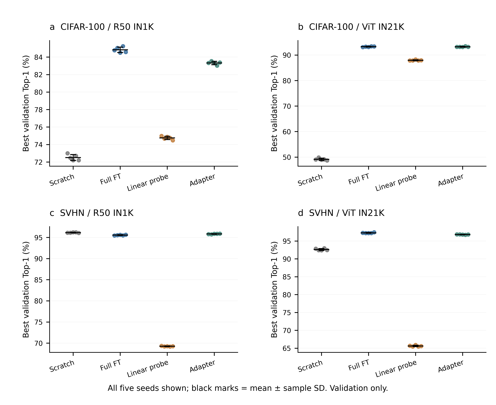
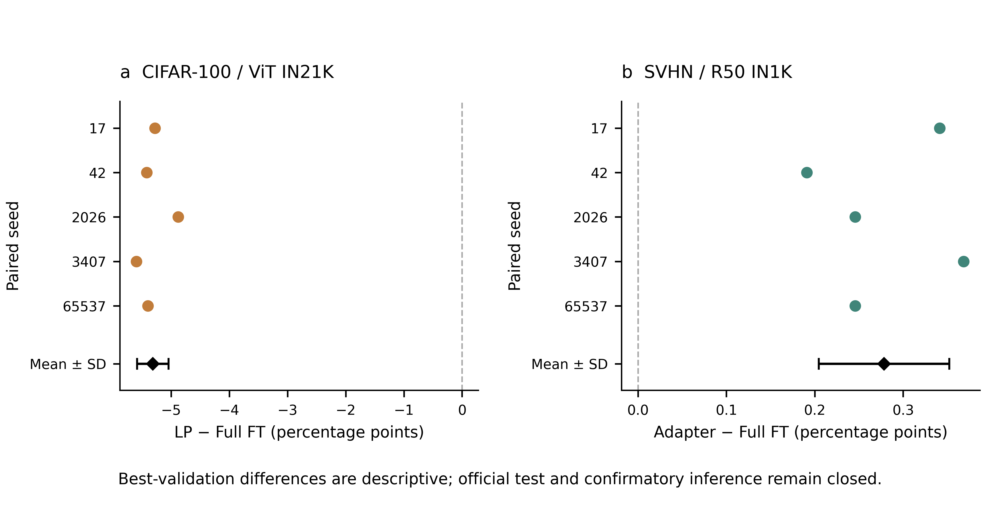
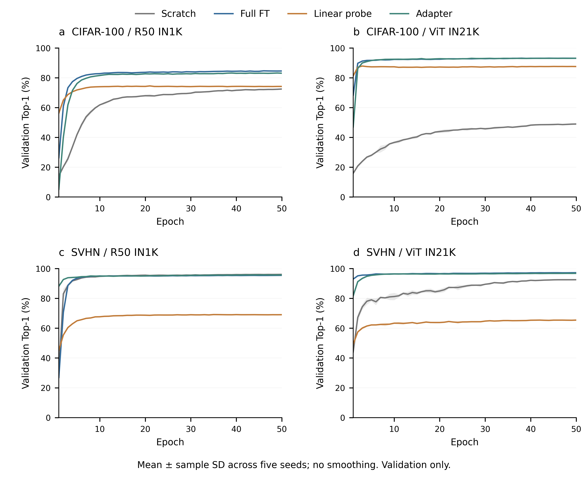
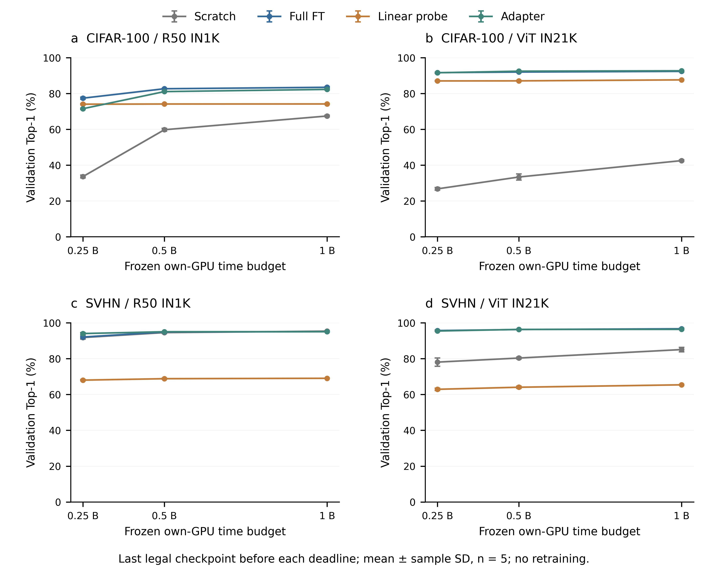

# P3-B 完整结果汇报与验收回执

2026-10-27。**P3-B：PASS，80/80 正式运行完成并封存；P3-C：NO_GO，等待另行审核。** 所有结果均为训练/验证证据，没有官方测试预测或测试指标。

本轮从服务器回收 17,121 个小型文本证据文件，原始合计 41,053,549 bytes，压缩包 9,724,237 bytes（约 9.72 MB），逐文件大小/SHA-256 全部通过。508 个 P3 checkpoint 留服务器，没有回收大模型。

## 完成状态与证据

|项目|核验结果|
|---|---|
|正式矩阵|16 配置 × seeds 17/42/2026/3407/65537 = 80；每次 50 epochs|
|已提交训练|4,000 epochs；221,862,000 样本次；1,736,000 optimizer updates|
|已提交验证|24,652,000 样本次；仅原冻结 validation split|
|恢复与初始条件|80 个首次 attempt 均 fresh；4 次合法基础设施恢复，未继承 P2 checkpoint|
|最佳模型|逐轮重算 Top-1、并列最早轮；best/last 指针及封存哈希吻合|
|确定性配对|20 个 dataset/backbone/seed 初始头一致；1,000 个对应 epoch 四策略 sampler 顺序一致|
|预算切片|240/240 available；每点选 deadline 之前最后一个完整、哈希验真的 checkpoint|
|评价清单|80 best + 80 last + 240 prefix = 400 个唯一 evaluation_id；400 个不同缓存键|
|实际执行来源|2,740 epochs 为 7247c661；1,260 epochs 为 700a1adc；54/26 个终态 summary 分别绑定两提交|
|历史保全|两次恢复前54/65个完整run的保留哈希均一致；P1 40、P2 128个checkpoint重新计算哈希通过|
|异常终态|数值失败/OOM/协议失效均为0；4个被暂停attempt保留并结算|
|测试边界|P3_C_authorized=false，centralized_test_authorized=false；未构造测试 evaluator|

训练样本次数指完整提交事务的计数，**所有 attempt 的实际物理样本处理总数 UNKNOWN**：中断时未提交的半轮工作没有完整采样日志，不能把 221,862,000 冒充含失败重算的精确物理总量。GPU 台账则完整包含这些时间。四个恢复 run 的 summary `fresh_initialization=false` 表示“最后一次 attempt 从同 run checkpoint 恢复”；首次 attempt 的 `resume=false`、`resumed_generation=null` 已逐一验证，不应误读为继承 P2。

`progress.json` 是调度循环最后快照，可能仍标记 running；终态以 stage_status=P3_runs_terminal、80个completed summary、92个finalized attempt及P3 seal共同确认，未将旧进度字段当作仍在训练。

## 五种子最佳验证结果

下表为每个 run 从 50 轮中选择的最佳验证 Top-1 的均值 ± 样本 SD，n=5；不是标准误或置信区间。选择使用了同一验证集，成绩具有选择偏差。`last` 的五 seed 均值/SD、80个原始成绩、4,000轮 train/validation loss及准确率见随附 CSV。

|配置|冻结 LR|最佳验证 Top-1 (%)|最后轮验证均值 (%)|累计 GPU-hours|
|---|---:|---:|---:|---:|
|cifar100-r50-adapter|0.0001|83.320 ± 0.189|83.088|5.8896|
|cifar100-r50-full_ft|0.0001|84.828 ± 0.311|84.576|5.6075|
|cifar100-r50-linear_probe|0.003|74.756 ± 0.192|74.208|2.2080|
|cifar100-r50-scratch|0.003|72.512 ± 0.343|72.476|5.6040|
|cifar100-vitb16-adapter|0.0001|93.232 ± 0.129|93.124|7.8108|
|cifar100-vitb16-full_ft|1e-05|93.264 ± 0.138|93.112|10.0871|
|cifar100-vitb16-linear_probe|0.001|87.948 ± 0.182|87.572|3.7239|
|cifar100-vitb16-scratch|0.0003|49.100 ± 0.456|48.996|10.0475|
|svhn-r50-adapter|0.001|95.820 ± 0.065|95.738|8.5570|
|svhn-r50-full_ft|0.0001|95.542 ± 0.084|95.452|8.1707|
|svhn-r50-linear_probe|0.003|69.255 ± 0.067|69.042|3.1099|
|svhn-r50-scratch|0.001|96.134 ± 0.068|96.088|8.3490|
|svhn-vitb16-adapter|0.0001|96.809 ± 0.057|96.781|11.2910|
|svhn-vitb16-full_ft|3e-05|97.270 ± 0.097|97.224|14.4524|
|svhn-vitb16-linear_probe|0.001|65.618 ± 0.185|65.422|5.3039|
|svhn-vitb16-scratch|0.0003|92.621 ± 0.273|92.517|14.3726|

## 两项预注册主比较的验证观察

|比较（前者减后者）|五个配对差值，seed依次17/42/2026/3407/65537 (pp)|均值 ± 配对 SD (pp)|
|---|---|---:|
|cifar100-vitb16-linear_probe-minus-full_ft|-5.280, -5.420, -4.880, -5.600, -5.400|-5.316 ± 0.269|
|svhn-r50-adapter-minus-full_ft|+0.341, +0.191, +0.246, +0.369, +0.246|+0.278 ± 0.074|

CIFAR-100/ViT 的 LP 在五个 seed 上均低于 Full FT，均值差 −5.316 pp；当前验证证据不支持 LP 优势。SVHN/R50 的 Adapter 五个配对差值均为正，均值 +0.278 pp，但 Scratch 验证均值 96.134% 还高于 Adapter 95.820%；因此不能把局部主比较推广成 Adapter 对所有方法最优。

CIFAR-100/ViT 的 Adapter 与 Full FT 最佳验证均值相差 −0.032 pp，只能描述为数值接近，不能据此声称等效。SVHN 的冻结骨干 Linear Probe 较低（R50 69.255%、ViT 65.618%），与全量/Adapter 的差距跨五 seed 稳定；ViT Scratch 在 CIFAR-100 为49.100%。这些是当前冻结配方下的观察，尚无因果消融，不能归因到某一单独结构、LR 或数据域因素，也不能事后扩网格。

## 学习过程与共同时间预算

验证曲线保留50轮、不平滑。LP 较早接近平稳；Full FT 和 Adapter 在两组 SVHN 上达到较高验证成绩，Scratch/ViT 仍呈更慢的提升。68/80 个最佳轮次早于第50轮，故 best 与 last 的评价角色需要同时保留。没有观察到非有限更新终止，但这不能证明旧稿 NaN 的因果机制已解决。

四组 B 仍取冻结 JSON 的完整精度，未依据成绩调整。时间包括自身初始化、训练、验证、保存/哈希/必要退出及恢复开销，排除排队和暂停空档。每个 prefix 是同一条训练轨迹的复用，不是额外独立训练；240 个都找到了预算前合法快照，逐一核对完成时刻与最晚合法轮次。原始快照和保护哈希均列在 prefix_manifest/checkpoint_inventory。

## 暂停原因、恢复与执行身份

1. 首次暂停由旧预测公式给已经发生的费用再乘25%余量引起，不是真实超过160小时。修正为“实际已耗时 + 1.25×未来训练及预留”，硬封顶和历史费用均保留。54个已完成run没有重跑；R50 Full FT seed42、Scratch seed2026从第37/3轮恢复。真实checkpoint下一步更新逐位一致的GPU验收及20项CPU验收已留档。
2. 第二次暂停由 CIFAR-100/ViT/LP seed17 的完整第2–3轮55.2231s、相对冻结P2中位50.0932s慢10.2408%触发；仅比10%线多约0.1206s。与P2同第2–3轮比较时增幅约6.96%；主要观测增量来自checkpoint保存路径（约2.15s），训练约1.35s、验证约0.10s。证据支持固定snapshot/hash/GC开销解释，未采样历史磁盘带宽，不能断言物理磁盘故障。按既有继续授权完成范围限定调查，只接受该配置五个预注册seed的已知开销；其他配置和未知故障没有全局放行。两个LP从第3/35轮恢复。

实际源码只在已审查的6个运维文件变化；common/data/models/engine、事务实现、测试门禁及原科学身份不变。54个summary仍保持7247c661，26个为700a1adc，不伪造全阶段同一执行提交；独立核验逐轮绑定真实Git blob，检查54/65份保留哈希。当前报告和证据归档commit是交付提交，与服务器实际执行700a1adc分开记录。

## GPU 与存储结算

实际占用 **124.610609507/160 GPU-hours**，剩余 35.389390493。其中84个正式attempt共124.584922131小时，8个GPU工程验收attempt共0.025687376小时；4个被暂停attempt已计入，不能从总账扣减。两个GPU的所有区间逐卡检查无重叠。

|attempt终止原因|数量|GPU-hours|
|---|---:|---:|
|completed|88|123.108738580|
|projected_total_with_reserves_exceeds_160_gpu_hours|2|0.914224192|
|slowdown_above_10_percent_investigate_before_dispatch|2|0.587646734|

台账最早GPU验收至最后GPU任务退出：2026-10-22T08:24:13.718571+00:00 至 2026-10-27T06:11:00.441412+00:00，日历跨度 117.780 小时；包含排队/长暂停，不能当作GPU小时。封存UTC为 2026-10-27T06:23:06.338897+00:00。学校服务器无计价，不虚构金额。

服务器为2×RTX3090 24GiB、16 vCPU、64GiB内存；训练日志的最大单run显存峰值allocated 3.599 GiB、reserved 4.633 GiB。封存时项目+独立环境逻辑文件占用 160.635 GiB，物理盘可用约 13.500 TiB。此统计排除symlink、每根目录内hardlink去重，不等于conda共享包缓存的独占物理空间。P3 checkpoint 508个，共116.215 GiB；P1/P2原始checkpoint保留。

200GiB是历史最低资源保障，不再是人为存储封顶；遵循用户后续授权保留物理空间10GiB退出余量+4GiB原子保存保护。存储台账为分时采样，封存统计之后本次文本导出/复核收据仍会少量增加项目占用；不把台账中的历史剩余额度当作当前硬限制。

## 下一阶段提案：仅待审，不执行

已冻结的评价草案含400个角色、400个不同checkpoint推理键，本次没有可省略的重复键。按P3第2–50轮验证时间中位数及已知test样本规模外推，纯推理约 **1.487 GPU-hours**，加25%未来余量约 **1.859**；不同batch、模型加载、哈希与预测压缩写入尚未实测。建议另行批准 **3.0 GPU-hours 的集中评价子预算**（含加载、推理、写入、必要诊断/重试），而不是把原1.464638小时估计当作已测上限。它仍位于160总封顶内，批准后总量最多约127.611小时；本轮没有动用这项额度。预计新增输出按5GiB规划，保留全部checkpoint，无需回收大文件。

启动仍需用户单独明确批准P3-C、锁定seal与评价manifest的SHA、外部HMAC签名授权和原共享台账保护。不得测试后更换LR或模型；正式统计按冻结两项配对五seed t区间、两项优势检验Holm校正及CIFAR/ViT LP−FT −0.5pp非劣界执行。本报告不对验证成绩做正式优势/非劣裁定，不启动扩展实验或论文定稿。

## 交付索引与复核方式

- [独立验收](../records/p3/delivery_audit.json)、[服务器只读复核](../records/p3/server_closeout_verification.json)、[P3封存](../records/P3_sealed.json)、[评价草案](../records/p3/evaluation_manifest.draft.json)。
- [逐run验证结果](P3_validation_runs.csv)、[16组汇总](P3_validation_configurations.csv)、[全部逐轮曲线数据](P3_epoch_curves.csv)、[prefix验证数据](P3_prefix_validation.csv)、[逐attempt台账](P3_attempts.csv)、[存储时间线](P3_storage_timeline.csv)、[后续预算JSON](P3_C_待审预算.json)。
- [完整原始文本归档](../evidence/P3_final_20261027/text_evidence.tar.gz)、[逐文件manifest](../evidence/P3_final_20261027/snapshot_manifest.json)、[传输收据](../evidence/P3_final_20261027/receipt.json)。17,121个文件逐一核验；P3二进制哈希由服务器独立终态审计提供，本机仅核对其封存及引用一致性。
- 原始归档解压至独立目录后，在仓库运行 `python tools/verify_p3_delivery.py --snapshot <解压目录>` 可重算验收和CSV（缺省未导出的P2账本从已接受归档读取并核对冻结SHA）。图源为 `tools/plot_p3_results.py`；全部图提供PDF/SVG/PNG及对齐、字体、碰撞QA记录。

封存SHA-256：`977d8c69bef9f6a783b4f5188102e5d25f1e55497b3ed1e79791265a7d02c8c6`。GPU账本SHA-256：`a9f10816b7f8d6421c48bb6149dd82b2a681821272886e07484c6d316054ca00`。阶段终点是P3-B已封存；P3-C与集中测试继续关闭。

交付收尾已完成：服务器低频监控已自行退出，桌面每30分钟定时任务已暂停并读回确认；未归档聊天。见 [收尾回执](../records/p3/delivery_closeout.json)。
